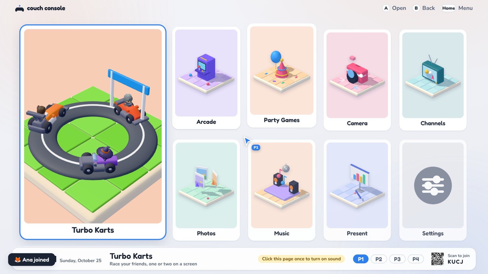
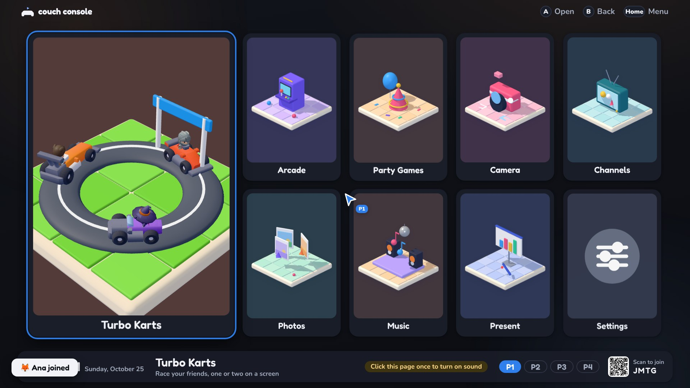
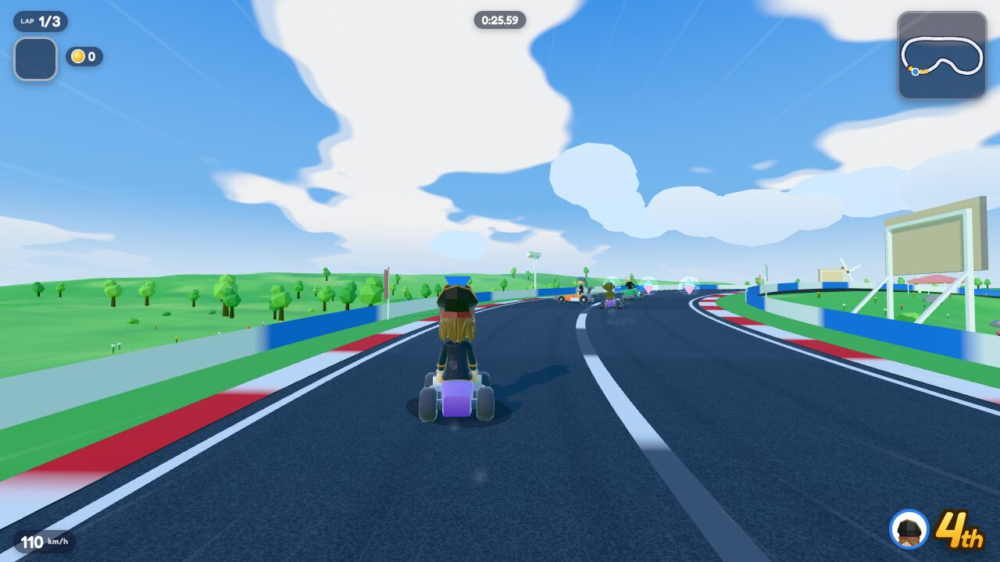
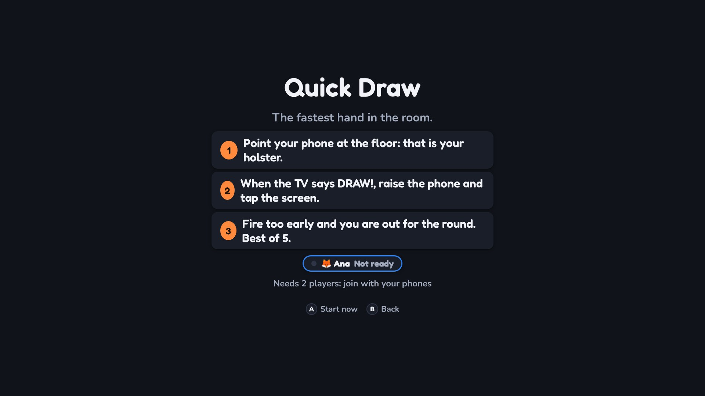
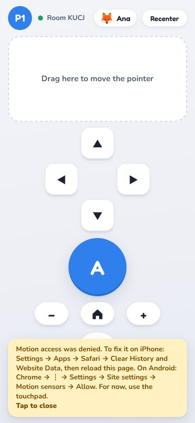

# Couch Console

A game console that runs in your web browser, and your **phone is the controller**.
Your laptop (or a TV connected to it) shows the home menu and the games; everybody joins by scanning one QR code. No app, no account, no cloud: it all stays on your own Wi-Fi.

| Home (light) | Home (dark) |
|---|---|
|  |  |

| Turbo Karts | Party Games | The phone |
|---|---|---|
|  |  |  |

## What is in it

- **Turbo Karts**: a 3D kart race with 8 tracks, 8 characters, drift boosts, items and a split screen for 2 players. The phone turns into a kart pad (buttons or a tilt wheel, with haptics).
- **Party Games**: *Quick Draw*, *Hot Potato* and *Steady Hands*, where every phone is a controller (holster, swing, tilt).
- **Photo Booth**: the webcam as a mirror with frames and face stickers; photos go to the party album.
- **Arcade**: Table Tennis, Air Hockey, Bowling, Target Range, Paddle Duel, Balloon Pop, Juicy Slash, Alien Strike, Gem Dungeon and Draw.
- **Channels**: Photos (a shared album), Music (a fair YouTube queue), Present (slides from your phone), Weather, Video, Timer and On This Day.
- Light, Dark or Auto theme (the phones follow the TV), 1 to 4 players plus unlimited guests, and everything works with a keyboard if you have no phone.

All the details (controls for every game, settings, debug tools) are in [docs/GUIDE.md](docs/GUIDE.md).

## Run it

You need [Node.js](https://nodejs.org) 20 or newer (the "LTS" download).

```
npm install
npm start
```

Then open the address it prints (`http://localhost:3000`) on the laptop, press **F11** for full screen and click the page once so the browser may play sound.

## How phones join

1. Scan the **QR code** on the screen with the phone camera (or open `/remote.html` on the phone and type the 4-letter room code).
2. Pick a name, then **Play** (you get a controller, P1 to P4) or **Just join** (a guest: Photos, Music and Present, no controller).
3. Tap **Tap to start**. On an iPhone, allow motion access when it asks.

Phones only give out their motion sensors on secure (`https://`) pages, so for tilt and swing you need one of these (both are explained step by step in the guide):

- **Tunnel:** `cloudflared tunnel --url http://localhost:3000`, then open the `https://…trycloudflare.com` link on the laptop.
- **Local certificate (faster):** `npm run certs` once, install the certificate on each phone, then use the `https://` address `npm start` prints.

No phone? On the QR screen choose **No phone? Use mouse & keyboard** (arrow keys, Enter = A, Esc = B, H = Home).

## Project layout

```
server/        the Node server (index.js) and its party features: people, photos, music, slides, saved data
public/
  console.html, remote.html   the laptop (TV) page and the phone page
  console/     laptop code: menu, settings, pointer, sound, party
  phone/       phone code: remote pad, kart pad, haptics, photo booth, party games
  games/       one file per game (+ a .game.json); turbo-karts/ holds the big one
  apps/        the channels: Photos, Music, Present, Weather, Video, Timer, On This Day
  shared/      what both sides use: socket events, theme, clock, avatars
  css/         design tokens (theme.css), shared components, one file per area
  assets/      models, icons, sounds
scripts/       make-certs, render-icons, build-cast, qa-shots
tests/         automatic tests (npm test)
docs/          the guide, screenshots, and a test checklist
```

A game is a `<name>.js` plus a `<name>.game.json` in `public/games/` (or `public/apps/`); the menu finds it by itself. `npm test` runs the unit tests and, if [Playwright](https://playwright.dev) is installed (`npm install` adds it), the end-to-end tests that drive a real browser with two fake phones.

## Credits

Free assets and libraries: Kenney (car and racing kits, sounds), Quaternius (pirate kit), KayKit (characters), Poly Haven (a road texture), Google MediaPipe (face tracking), three.js, GSAP, PixiJS, Howler, pdf.js, socket.io and Express. The kart rules are a port of [OpenWii](https://github.com/pattssun/OpenWii) (MIT). Everything else is original, and nothing here uses Nintendo assets.
Full list with licenses: [THIRD_PARTY_NOTICES.md](THIRD_PARTY_NOTICES.md).
