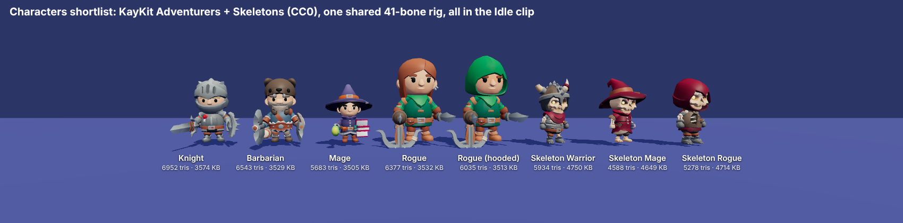
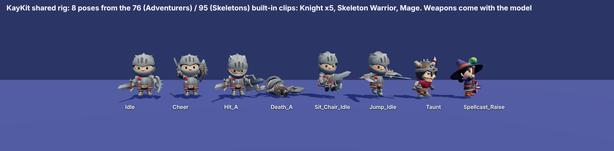
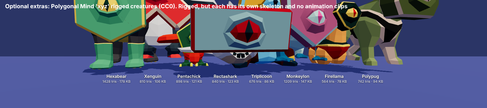
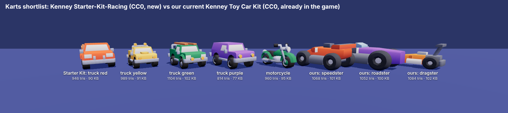

# Reference audit (Phase 0)

Research only: no game, menu, server or test code was changed. Date: 2026-10-24. Branch `claude/serene-mayer-xi5scd`.
Every claim below comes from reading the cloned code, running our app headless, or running a small experiment. Where I
could not verify something, it says so.

**How it was done.** Repos cloned (shallow) into `/tmp/refs`, outside our repo, never committed. Our app was driven in headless
Chromium (Playwright, software WebGL) with a throwaway script that joins a fake phone, opens Turbo Karts, picks a racer and
starts each track. A second throwaway page rendered the asset lineups. A copy of the repo in `/tmp/trial` was used to test
the three.js upgrade. None of these scripts are committed.

**Caveats you should know first**
- Headless software WebGL runs races at about 1–4 fps (Grand Stadium: under 0.5 fps). Game time is fixed-step, so the pictures
  are right, but **no frame-rate number from the race is meaningful**. The select-screen numbers are only useful as *relative*
  differences (section 4).
- `docs/HANDOFF.md` does not exist in the repo, so I could not read it. I did not create it (no other changes were allowed).
- Two references could not be audited (section 1): "Nathan-Richard-21/Mario-Kart-game" does not exist at any URL I could
  try, and the Colyseus Karts source is not public.
- Nothing here was tested on a real phone, TV or GPU.

---

## 1. License table

I read each `LICENSE` file myself. "No LICENSE file" means look-only, whatever the README says.

| Repo (commit date) | License I found | Can we copy its **code**? | Assets | Nintendo / other IP inside | Stack | three.js |
|---|---|---|---|---|---|---|
| **pmndrs/racing-game** (2023-02) | MIT (`LICENSE.md`, "pmdrs, contributors") | **Yes**, with credit in `THIRD_PARTY_NOTICES.md` | README says "CC0 assets only" (claimed, not checked file by file) | None | React Three Fiber 8, cannon raycast vehicle, leva, Vite 2 | 0.139 |
| **Lunakepio/Mario-Kart-3.js** (the upstream I could find; 2025-12) | **No LICENSE file.** README shows an MIT badge only | **Look-only** | Nintendo | **Yes**: `Mario-circuit-test.jsx` (a Mario Circuit track model) and the repo name | R3F, Rapier, GSAP, Playroom Kit, WebGPU canvas, leva | 0.176 |
| **0xikarus/Mario-Kart-3.js** (older fork, 2024-03; `bunbolabs/` is the same code) | MIT file present, holder "[2022] [Ron Waller]" (a template name, not the author). The upstream has no license file, so I **do not trust it** | **Look-only** (ideas are free) | Nintendo | **Yes**: `Mario_kart.jsx`, `Mario_kart_item_box.jsx`, `Super_mario_bros_coin.jsx`, `Mario_shell_red.jsx`, `Banana_peel_mario_kart.jsx`, mushroom/shell/banana images | R3F 8, Rapier, GSAP, leva, Vite 4 | 0.160.1 |
| **Nathan-Richard-21/Mario-Kart-game** | **Not found.** Tried 8 URL variants; GitHub search is blocked in this sandbox | n/a | n/a | n/a | n/a | n/a |
| **thatshaman/CharrioKart** (2018) | MIT (`LICENSE`, "2017 that_shaman") | Yes, but nothing worth porting | Third-party IP: Guild Wars 2 track and character names (ascalon, kryta, shiverpeak, `taimi`…) and, most likely, the art (ArenaNet) | **Do not copy any asset** | Vanilla JS, tile-based pseudo-3D, howler | r84 (bundled `three.min.js`, 2017) |
| **samwillis/pingbin-cart** (2025-03) | README says "MIT" but **no LICENSE file** anywhere | **Look-only** | Original (procedural Pingbin and Bunny) | None | R3F 9, React 19, TypeScript, Vite 6 | 0.174 |
| **tim4724/Stacker-Party** and **Tetris-Party** | **No LICENSE file.** They are the **same repo** (identical commit); Tetris-Party is a second name | **Look-only** | Original | "Tetris" is a trademark in the name | Vanilla JS (UMD), 2D canvas, `node:test`, Playwright, WebRTC | none |
| **Colyseus Karts** (`colyseus/racing-karts-demo`, found in `colyseus/docs`) | Repo **not accessible** (asks for credentials: private or premium). The docs repo is MIT | n/a (idea only, from the docs text) | n/a | n/a | three.js (version unknown) | unknown |
| **FlakeOrg/Wii-Menu** (2025-11) | MIT (`LICENSE`, "2025 FlakeOrg") | Yes, but it is one 19 KB HTML file | `wiimenu.mp3` is the **Nintendo menu music: never copy** | **Yes**: Disc/Mii/Photo/Shop/Forecast/News Channel names, "Wii" | Plain DOM + CSS | none |
| **adrenak/tork** (2020) | MIT (root `LICENSE` and `Assets/Tork/LICENSE`, "Vatsal Ambastha") | C# Unity: concepts only | Sample assets only | None | Unity C# | none |
| *Asset sources* | | | | | | |
| **KayKit Character Pack: Adventurers 1.0** | **CC0** (`LICENSE.txt`, Kay Lousberg) | Assets: **yes** | CC0 | None | glTF/FBX/Godot | n/a |
| **KayKit Character Pack: Skeletons 1.0** | **CC0** (`LICENSE.txt`) | Assets: **yes** | CC0 | None | same | n/a |
| **KenneyNL/Starter-Kit-Racing** | Code: MIT (`LICENSE`, Kenney 2023). README: models, sprites and sounds are **CC0** | Assets: **yes** | CC0 (skid sound by Landeplage, also CC0) | None | Godot 4 | n/a |
| **ToxSam/open-source-3D-assets** | Registry JSON is CC0. The models live in other repos (`ToxSam/cc0-models-Polygonal-Mind`, per-collection license shown as CC0). I downloaded 8 and they fetch fine from `raw.githubusercontent.com` | Assets: yes, per collection | CC0 | None | n/a | n/a |
| **ToxSam/open-source-avatars** | Registry is CC0, but **each collection has its own license** (100Avatars R1–R3 CC0; VIPE Heroes Genesis is CC-BY, needs credit). VRM format | Check per avatar | mostly CC0 | None | VRM (anime style) | n/a |
| *Already in our repo* | OpenWii (MIT, credited), Quaternius characters and Pirate Kit (CC0), Kenney Toy Car Kit and Racing Kit (CC0), Poly Haven (CC0) | | | | | 0.160 |

**What this means for the plan**
- REBUILD-PLAN says Mario-Kart-3.js and pingbin-cart are MIT. Neither can be treated as copyable: one has no license file and
  one has a doubtful template file; pingbin has no file at all. Stacker-Party/Tetris-Party are the same repo with no license.
- **We never need to port code from those.** The techniques we want are small and well known; I recommend REIMPLEMENT from the
  idea in every case where the source license is not clean. The only clean code sources are pmndrs/racing-game (MIT) and tork
  (MIT, but C#).
- **Our own repo has a small IP risk** (found while screenshotting): Grand Stadium shows a red mushroom medallion and the word
  "MOTOKART" (`stadium-pylons.js:21`, `stadium-paddock.js:70`, `stadium-architecture.js:218`, `stadium-pitlane.js:260`).
  Both come from the OpenWii stadium. A white-spotted red mushroom plus "Kart" reads as Mario Kart. Recommend rebranding
  before anything is shown publicly (S).

---

## 2. Area by area: ours vs the best reference

Short answer: **our code is ahead of every reference we could read** in the controller, effects, rendering, items, AI and
laps (it comes from OpenWii, which is more complete than any of these). The references are better in only a few small
places, listed under "Adopt".

### a. Kart controller

| | Ours | Best reference |
|---|---|---|
| Model | Kinematic "on rails": heading integrated, position projected onto the track spline, fixed 120 Hz, seeded, unit-tested (`public/js/console/games/turbo-karts/ow-kart/rules.js`) | pmndrs: cannon raycast vehicle with real suspension (`racing-game/src/models/vehicle/Vehicle.tsx`). MK3.js: Rapier body, speed damped by hand (`src/PlayerController.jsx`) |
| Drift start | Hop (0.36 s) on DRIFT press above 8 m/s; drift locks in when you steer (>0.14) above 12 m/s (`rules.js` `move`) | MK3.js: jump anim + direction from held key (`jumpPlayer`) |
| Counter-steer | Turn = `drift*0.12 + steer*0.92`, so steering inside a drift widens or tightens the arc; charge builds faster with more steering (`0.7+0.7*|steer|`) | MK3.js: `driftDirection*0.1` added to input turn, no charge dependence |
| Mini-turbo | 3 tiers at charge 0.8 / 2.0 / 3.4, boosts of 0.65 / 1.35 / 2.15 s, event per tier (`turboTier`) | MK3.js: 3 thresholds, boost durations 50/100/250 *frames* (frame-rate dependent) |
| Boost | Max 55 m/s, accel 35 | MK3.js: max +40 |
| Collisions | Wall slide with 0.86 speed loss, kart-to-kart contact response (`contact.js`) | pmndrs: physics bodies. MK3.js: custom `KartCollision.js` |
| Off-road | Top speed ×0.43 beyond `roadHalf+0.2`; no surface types | none better |
| Jumps / landing | Glide ramps only, fixed flight arc, landing boost 0.3 s and a squash bounce (`turbo-karts.js` 'land') | pmndrs: real ramps with physics (jumpy, hard to tune) |
| Frame-rate safety | Fixed step with 0.25 s catch-up cap | MK3.js multiplies by `delta*144` all over: breaks below 144 fps |

**Who is better: ours.** The plan's "Phase 2: sphere controller" is not supported by this audit. No reference does drift, counter-steer
or mini-turbo better than `rules.js`, and replacing it would throw away the deterministic 120 Hz model and its tests
(`tests/ow-kart-rules.test.mjs`). I recommend **keeping `rules.js` and adding feel on top**, then judging on a real phone.

**Adopt (all REIMPLEMENT: tiny, and the sources are look-only or C#)**
1. *Visual slip angle.* MK3.js damps the kart body yaw toward `angle*1.3 + drift*0.1` (`PlayerController.jsx`, `updatePlayer`). We snap:
   `m.root.rotation.set(0, yawOf(heading) + (drift ? -drift*0.35 : 0) …)` (`turbo-karts.js:~308`). Damping that offset (and adding
   the lean we already have) is what makes a drift look like a slide.
2. *Steer angle vs speed curve* (tork `MaxSteerAngleVsSpeed`, `Assets/Tork/Runtime/Addons`). Ours only ramps turning up with
   speed (`clamp(speed/20,-0.5,1)`); it never reduces it at top speed.
3. *Lateral friction vs slip curve* (tork `VariableLateralFriction`). Ours decays side velocity with a fixed `exp(-2.5 dt)`.
   A curve gives grip at low slip and slide at high slip.
4. *Tuning panel* (pmndrs uses leva). We can use `lil-gui`, which **already ships inside three** at
   `three/examples/jsm/libs/lil-gui.module.min.js`, so no new dependency.

### b. Effects

| Effect | Ours | Reference |
|---|---|---|
| Drift sparks | Tiered colour (blue/orange/purple) streak shader, 1400-point pool (`karts-fx.js`, from OpenWii) **and** three.quarks systems (`karts-quarks.js`) | MK3.js: four layered particle systems per side (`components/Particles/drifts`) |
| Boost flames | Two curling shader jets (`makeExhaust`) + quarks flame | MK3.js: shader flame particles; pmndrs: 12 blue cubes |
| Tyre smoke / dust | Smoke puffs while drifting; off-road dust; landing and wall puffs (`karts-quarks.js`) | pmndrs `Dust.tsx`: instanced spheres that shrink |
| **Skid marks** | **None** | pmndrs `Skid.tsx`: 500 instanced quads at the rear wheels while braking above 10 m/s. MK3.js `Skid.jsx`: up to 50,000 while drifting |
| Speed lines | CSS overlay, fixed pattern, only while boosting (`console.css:555`) | none better |

**Who is better:** ours for sparks, flames and smoke. **Gap: skid marks.** I could not capture sparks and flames reliably in
headless mode (see caveats); the Neon Avenue frame from the upgrade trial shows the flames and speed lines working
(`screenshots/audit-three-trial/neon-avenue-boost-three-0.186.1.png`). The thin vertical line under the kart in two of my forced-drift
frames (since deleted) may be a spark streak artifact at 3 fps; unverified.
**Adopt:** skid marks as a ring buffer of instanced quads (or a ribbon) placed at the rear wheels while drifting/braking,
fading out. REIMPLEMENT (pmndrs is MIT, but it is 58 lines of React; a port would be a rewrite anyway). Make speed lines scale
with speed, not just boost (S).

### c. Camera

| | Ours (`ow-kart/frame.js` `chasePose`, `turbo-karts.js` `moveCamera`) | Reference |
|---|---|---|
| Follow | Pose from the road frame, eye/aim lerp at 13/s, up at 7/s; never dips below the road | MK3.js: lerp 24/s toward a camera group; pmndrs: `lerp(v, delta)` |
| FOV with speed | 57 + boost×5 (+3 gliding, +2 boosting) | none |
| Drift offset | **None** | MK3.js shifts camera X toward the drift side and eases Z back 8 → 10 on boost (`PlayerControllerKeyboard.jsx` "CAMERA WORK") |
| Roll / lean | **None** | pmndrs rolls the camera with `steer × speed / 40` |
| Shake | **None** | pmndrs: sinusoidal sway that grows with speed and boost; chassis vibration |

**Who is better: the references**, in camera juice only. Our framing (low, close, looks ahead of the kart) is good and the road
clamp is better than theirs. **Adopt (REIMPLEMENT, S):** camera roll tied to steer×speed, a lateral shift in drifts, a pull-back
and FOV kick on boost, a small shake on boost/hit/landing, FOV tied to speed instead of only boost. Put the numbers in the
tuning panel.

### d. Rendering

Ours (`karts-look.js`, `karts-style.js`, `karts-polyhaven.js`): HalfFloat 4× MSAA target, depth-edge outline pass, GTAO,
UnrealBloom (or the `postprocessing` library chain with SMAA), banded "toon" grading, PBR Neutral tone mapping (patched into
three's shader chunk), vignette, rim light on karts, Poly Haven HDRI skies, a follow-shadow directional light (2048 map),
per-track lighting, automatic fall back to plain rendering under 40 fps.
References: MK3.js has a LUT/uniform colour grade (leva-tunable), bloom, and a commented-out N8AO; pmndrs has plain R3F
lighting. **Ours is clearly ahead.** The problems are art direction and performance, not technique (section 4).
**Adopt:** nothing technical. One idea: a colour-grade tuning panel (MK3.js `ColorGradingEffect.jsx`, look-only; REIMPLEMENT
with lil-gui). With three ≥ 0.162 the built-in `NeutralToneMapping` replaces our shader-chunk patch (`karts-look.js:52-58`).

### e. Items, AI, laps, HUD, minimap

| | Ours | Reference |
|---|---|---|
| Items | 6 items by behaviour (slick, orb, seeker, turbo, star, comet), box roulette, odds weighted by position (`rules.js` `rollItem`) | MK3.js: banana/mushroom/shell (Nintendo); pmndrs: none; Colyseus Karts: item boxes and rockets (private) |
| AI | Pure pursuit with a wandering lane, skill factor, rubber band to the leading human; takes shortcuts | none found in MK3.js (multiplayer only), CharrioKart or pmndrs |
| Laps | Eight sequential checkpoint gates per lap, interpolated finish time, same-step ordering (`rules.js`) | CharrioKart: one checkpoint tile; pmndrs: bounding-box goals |
| HUD | DOM overlay: lap, item slot, coins, place, countdown, results podium (GSAP) | pmndrs: speed gauge, clock, checkpoint, leaderboard, intro |
| Minimap | 2D canvas from the track samples, dots per kart (`drawMinimap`) | pmndrs: renders the real level from an orthographic camera into a texture, rotates with the player |

**Who is better: ours** on items, AI and laps. `docs/DECISIONS.md` mentions more items (Magnet, Bolt, Shield, Triple Slick);
the active rules have six, and those other icons are unused in `karts-data.js`. **Adopt:** pmndrs's intro polish and speed
gauge are optional; a rotating minimap is the only idea with real value (S–M), and it needs only our 2D canvas.

### f. Phone controller

| | Ours (`public/js/remote/kart-pad.js`, `wheel.js`, `motion.js`) | Best reference (Stacker-Party, look-only) |
|---|---|---|
| Tilt steering | Reads the accelerometer gravity vector (`atan2`), ±45° = full lock, no smoothing, no dead zone, no response curve (`wheel.js`) | n/a (their game uses touch) |
| Buttons | Multi-finger zones, thumb slides between buttons, smooth lock-in (0.16 s in, 0.08 s out), every touch-end path handled | Pointer events with a velocity history to tell swipe from hold, sensitivity slider (`public/controller/TouchInput.js`) |
| Haptics | `rumble(ms)` events sized by importance (turbo 80, hit 300, wall 120…), plus a tap vibrate; iPhone gets a sound instead (`remote/main.js:363`) | Role-based table (`move`, `drop`, `button`, `detent`) scaled by a user "Strong/Medium/Light" setting; muted in `?test=1` (`ControllerState.js:317`) |
| Latency | Socket.IO relay, 15 ms send interval, change filter; `?debug=1` shows ping | WebRTC DataChannel "fastlane": unordered, no retransmit, each packet resends the last few events, cumulative ack (`partyplug/PartyFastlane.js`) |

**Who is better:** ours for the pad; Stacker-Party for transport and haptic design.
**Adopt (REIMPLEMENT; no license):**
- Tilt v2: low-pass the angle, add a small dead zone and a gentle curve (fine near centre, firm at the ends); consider
  `deviceorientation`/gyro fusion, which `motion.js` already reads for the pointer. (M; judge on a phone.)
- Haptic *roles* with an intensity setting instead of raw milliseconds: drift tier 1/2/3 ticks, turbo kick, hit, wall, landing.
  iPhones cannot use `navigator.vibrate`. A known trick is the Safari 17.4+ `<input type=checkbox switch>` haptic; **unverified**,
  worth a 30-minute experiment on your iPhone.
- WebRTC DataChannel input is only worth it if the debug ping shows spikes on your Wi-Fi; measure first (L, low priority).

### g. Menus

Ours (`menu.js`, `home.css`, GSAP loaded on the side): tiles stagger in with `back.out` over 0.5 s, a focus "press" pulse, prefers-reduced-motion respected.
References: Wii-Menu is one HTML file with 0.2 s CSS transitions and a `popIn` keyframe; nothing from Nathan-Richard-21
(not found); pingbin has React screens for character/colour/track select; CharrioKart has a plain track editor page.
**Who is better: ours.** **Adopt:** nothing to port. For Phase 6 the channel-grid look is *our* design work (curved dock, live previews); the Wii
menu's sound and names are Nintendo's and stay out.
pingbin's character preview and colour picker screens (`src/components/game/screens`) are a decent reference for a
colour-your-kart step (look-only).

### h. Tests

| | Ours | Reference |
|---|---|---|
| Unit | `node:test`, 28 files, ~160 tests. **`npm test` today: 163 pass, 0 fail, 0 skipped** (the 155 that need no browser also pass on the upgraded three, section 7) | Stacker-Party: 48 `node:test` files (including parity and purity tests) |
| E2E | 8 Playwright files, each with its own copy of `findPlaywright()` and skipped silently when Playwright is missing | 10 `tests/e2e/*.spec.js` files with a shared `helpers.js`; the web server is started by `playwright.config.js` |
| Visual | **None** | **No pixel snapshots on purpose.** Their `CLAUDE.md`: UI regressions are caught with a "gallery": fixture scenarios selected by URL (`?test=1&scenario=…`), a capture script (`scripts/gallery/capture-web.mjs`) that fails on page errors and HTTP ≥ 400 so a half-broken page cannot pass as "a screenshot", and haptics muted in test mode |

**Who is better:** Stacker-Party's approach, adapted. Pixel-diffing our WebGL scenes would be flaky and slow (software GL ran our
races at 1–4 fps). **Recommend:** (1) scenario URLs (`?scenario=race-start&track=3&seed=…`), cheap because our `Race` is seeded; (2) a
capture script like the one used for this audit, saving a gallery of every track at start and mid-race for human review;
(3) `toHaveScreenshot` only for 2D screens (home, select cards) with a tolerance; (4) always assert "no console errors" and
"canvas not blank"; (5) move `findPlaywright` into one helper. REIMPLEMENT (S–M).

---

## 3. Where I could not compare
- **Colyseus Karts** (hold-to-drift mini-turbos, item boxes, rockets, rollback netcode) is private. Per the docs text, it is the
  only reference with the same features as ours; if you can share access or a zip, I will compare it.
- **Nathan-Richard-21/Mario-Kart-game** (GSAP menus, time trial, mobile layout): not found. Send the URL if you want it audited.

---

## 4. Our current look

Screenshots (1280×720, software WebGL, a fake phone, no `fx=off`, no `?debug`): `docs/screenshots/audit-before/`

| Screen | File |
|---|---|
| Home | `01-home.png` |
| Character, kart, track select | `02-character-select.png`, `03-kart-select.png`, `04-track-select.png` |
| Race start (countdown "3") and about 10 s into the race, each track | `t0-sunny-park-*`, `t1-dune-canyon-*`, `t2-frosty-peaks-*`, `t3-neon-city-*`, `t4-neon-avenue-*`, `t5-pirate-cove-*`, `t6-cloud-gardens-*` (`-a-start`, `-b-midrace`); `t7-grand-stadium-a-start.png` |

Grand Stadium has **no mid-race frame**: it did not reach 10 s of race time in 5 minutes of software rendering (a sign it is
the heaviest scene; Pirate Cove is next). In the mid-race frames the "player" is driven by the computer-driver steering code
through a test hook so the kart stays on the road.

### Your known problems: what I saw

| You reported | Result |
|---|---|
| Race camera starts off the track, kart not visible | **Not reproduced.** On all 8 tracks the camera sits behind the kart on the grid and the kart is clearly visible (single player). I did not test 2 players or "race again"; tell me where it happens. |
| Ground is one giant repeating brick texture | **Partly.** Neon City and Neon Avenue use Poly Haven `pavement_02` tiled every ~5 m (`karts-polyhaven.js:18`, `kart-track.js:115-118`), the likely "brick". It is mostly hidden under buildings in my frames, so I can't confirm the look. The other tracks use flat colour, lawn stripes or `rocky_terrain`/`snow_01` and look empty rather than brick. |
| Track floats on pillars over an empty plain | **Confirmed** on Sunny Park, Dune Canyon and Cloud Gardens: a raised road over flat ground and a bare horizon. Frosty Peaks and Pirate Cove are less affected. |
| Select screen runs at ~21 fps | **Reproduced and explained** (below). |
| Debug overlay shows by default | **Not reproduced.** `#debug` is hidden unless the URL has `?debug` (`main.js:18`, `:584`), and was hidden on all 8 tracks. The phone page *keeps* the flag in its URL (`remote/main.js:138,184`), so a phone opened once from a debug link keeps showing it. |

### Top visual problems (my list)

1. **Photographic skies clash with the toy art.** Frosty Peaks and Cloud Gardens show real trees, a lattice tower and a meadow
   horizon from Poly Haven HDRIs behind flat low-poly karts. "Gardens above the clouds" shows a grass-and-trees skyline.
   Sunny Park and Dune Canyon also show a real tree line at the horizon.
2. **Empty, flat ground and no horizon blend** on most tracks (confirmed floating road, see above). No fog, no skirt under the
   raised road, no scenery ring. Neon Avenue and Grand Stadium are the only tracks that feel built, and they are the best-looking.
3. **Road is too glossy**: the sun reflection blows out into a white haze patch in the mid-distance (Sunny Park, Dune Canyon,
   Pirate Cove, Cloud Gardens). It reads as fog, not asphalt.
4. **HUD**: the item slot is an empty dark square with no icon or hint; the minimap panel is translucent, so Neon City's buildings
   show through it; the lap text is small for a TV.
5. **Track select** is plain gradient cards with no previews, and white text on the light Frosty Peaks card is hard to read.
6. **Select screen performance** (next section).
7. **Grand Stadium branding** (mushroom + "MOTOKART"), see section 1.
8. Positives worth keeping: the home screen, Neon Avenue, Grand Stadium, Pirate Cove, readable kart silhouettes, and the
   countdown/"GO!" punch.

### Why the select screen is slow (experiment)

Same page, same machine, software WebGL, 1280×720, fps averaged over 3 s, three samples each; only the changed thing differs.
Read these as *relative* costs, not real-GPU numbers.

| Variant | fps |
|---|---|
| Baseline (DPR 1, antialias on) | 32.5–33.8 |
| **Device pixel ratio 1.5** | **22.3–22.5** (close to the ~21 you see) |
| WebGL canvas hidden by CSS | 38–41 |
| Skip `fx.update`/`qfx.update` while on the select screen | 32.6–34.2 (no gain) |
| **Renderer `antialias: false`** | **58–60** |
| Clear only, no showroom draw | 60 |

Cause: the select screen draws two small 3D previews into a **full-window, alpha, multisampled canvas** at pixel ratio up to
1.5 (`turbo-karts.js:585-589`, `renderShowrooms`). The cost scales with the whole canvas, not the previews. Particle updates and
CSS are not the problem. **Fix (S):** while on the select screen use a non-MSAA context or small render targets/canvases sized
to the preview boxes, and pixel ratio 1; or render the previews at 30 fps. Verify on the laptop with `?debug=1`.

---

## 5. Assets (CC0 only, fetched from GitHub)

Renders: `docs/screenshots/audit-assets/`. Nothing was added to the game.

### Characters

Both KayKit packs ship the **same 41-bone rig with every animation baked into each GLB**, so any clip plays on any of these
characters. 76 clips in Adventurers and 95 in Skeletons, including `Idle`, `Cheer`, `Hit_A`, `Death_A`, `Sit_Chair_Idle`,
`Jump_Idle`, `Taunt` (Skeletons), `Spellcast_Raise`. The weapons and shields are meshes in the model and can be hidden.

| # | Character | File | Size | Triangles | Notes |
|---|---|---|---|---|---|
| 1 | Knight | `Adventurers/Characters/gltf/Knight.glb` | 3.5 MB | 6,952 | |
| 2 | Barbarian | `Barbarian.glb` | 3.4 MB | 6,543 | |
| 3 | Mage | `Mage.glb` | 3.4 MB | 5,683 | |
| 4 | Rogue | `Rogue.glb` | 3.4 MB | 6,377 | |
| 5 | Rogue (hooded) | `Rogue_Hooded.glb` | 3.4 MB | 6,035 | |
| 6 | Skeleton Warrior | `Skeletons/Characters/gltf/Skeleton_Warrior.glb` | 4.6 MB | 5,934 | 2 materials |
| 7 | Skeleton Mage | `Skeleton_Mage.glb` | 4.5 MB | 4,588 | |
| 8 | Skeleton Rogue | `Skeleton_Rogue.glb` | 4.6 MB | 5,278 | |

**Versus what we ship today** (Quaternius Ultimate Animated Character Pack, CC0): 23 bones, 17 clips including `Idle`, `Victory`, `Defeat`;
1.7–2.2 MB per file; 2.1k–9.5k triangles (`public/assets/quaternius-characters/glTF`). So the **real gain from KayKit is a more
consistent, chunkier, textured toy style plus `Cheer`, `Hit`, `Death`, `Sit` and `Jump` clips, not "animations we lack"**. Costs: 8 files total ~30 MB
(each carries 76–95 clips); trim to the 6–8 clips we use at import time (needs a small build-time tool such as gltf-transform, a
new dev dependency I would ask you about first), or keep them and accept a 30 MB first load on the LAN.
Faces are usable from behind-and-above, which is the race camera. Needs a seat offset for the kart (we already use one per kart).

Optional extras: Polygonal Mind "xyz" creatures (CC0, from `ToxSam/cc0-models-Polygonal-Mind`): 8 sampled, 564–1,428 triangles, 78–178 KB each,
**rigged but each with its own skeleton (15–37 bones) and no clips**, so they would need hand-made animation. Good as non-playable
mascots or kart-seat toys, not as a playable cast. 
Open Source Avatars (VRM) are anime-style and mixed-license (one collection is CC-BY): not a fit.

### Karts

Kenney Starter-Kit-Racing (CC0) models share one colour-map texture, which matches our existing Kenney Toy Car Kit.

| # | Kart | File | Size | Triangles |
|---|---|---|---|---|
| 1 | Truck red | `models/vehicle-truck-red.glb` | 90 KB | 946 |
| 2 | Truck yellow | `vehicle-truck-yellow.glb` | 91 KB | 989 |
| 3 | Truck green | `vehicle-truck-green.glb` | 102 KB | 1,104 |
| 4 | Truck purple | `vehicle-truck-purple.glb` | 77 KB | 814 |
| 5 (option) | Motorcycle | `vehicle-motorcycle.glb` | 95 KB | 960 |
| (ours today) | speedster / roadster / dragster / racer | `public/assets/car-kit/Models/GLB format/` | ~100 KB | ~1,050–1,085 |

Honest take: the Starter Kit "trucks" are **not karts**, and our existing Toy Car Kit karts (open-wheel speedster, roadster, dragster)
look more like karts and are the same style. Recommendation: **keep our four karts** and add the 4 trucks only as a "Trucks" class
if you want variety. The kit also has modular track pieces (`track-straight/corner/bump/finish`, `decoration-forest/tents`,
106–1,900 triangles) that could dress our tracks (M).

---

## 6. Top-10 upgrades, ranked by "feels better" vs effort

S = under half a day · M = about a day · L = several days.

| # | Upgrade | Feel gain | Effort | Port or reimplement | Source |
|---|---|---|---|---|---|
| 1 | **Fix the select-screen frame rate** (no MSAA / full-window canvas on select; DPR 1) | High: the first screen you see is smooth | S | Own fix | measured, section 4 |
| 2 | **Track art pass, step 1: replace photo skies with stylised ones, add fog/horizon blend, ground detail, lower road gloss** | Very high: fixes 3 of the 5 worst problems | S–M for all tracks; M per track for props | Own work; CC0 props (Kenney/Quaternius) | screenshots |
| 3 | **Camera juice**: roll with steer×speed, drift lateral shift, boost pull-back, speed-based FOV, shake on boost/hit/land | High | S | REIMPLEMENT | pmndrs `Vehicle.tsx`, MK3.js "CAMERA WORK" |
| 4 | **three.js upgrade** 0.160 → 0.186.1 (+ postprocessing, quarks), drop our tone-map patch | Medium (prereq; new features, fewer hacks) | S–M | n/a | section 7 |
| 5 | **Skid marks** + nicer dust trail | Medium-high: the road finally remembers the drift | S | REIMPLEMENT | pmndrs `Skid.tsx` |
| 6 | **Kart body response**: damped slip angle, steer-vs-speed curve, lateral friction curve, wheel steering | High (feel) but needs a phone to judge | S–M | REIMPLEMENT | MK3.js `updatePlayer`, tork addons |
| 7 | **Tuning panel** (lil-gui from three addons) for handling, camera, fx, grade | Medium: makes #3 and #6 fast to get right | S | REIMPLEMENT | pmndrs leva panel |
| 8 | **Phone v2**: tilt smoothing + dead zone + curve; haptic roles with intensity; test the iOS switch-haptic trick | Medium-high on phones | M | REIMPLEMENT | Stacker-Party `ControllerState.js` |
| 9 | **New cast**: KayKit characters with clip trimming, seated pose, `Cheer`/`Hit` reactions | High charm | M | Assets are CC0 | section 5 |
| 10 | **Gallery capture + scenario URLs + shared Playwright helper** | Indirect: stops visual regressions | M | REIMPLEMENT | Stacker-Party `scripts/gallery` |

Quick extras that are not "feel" but are cheap: HUD item-slot hint and an opaque minimap (S); track-select preview cards
(S–M); rebrand the stadium mushroom/"MOTOKART" (S).

---

## 7. three.js upgrade recommendation

**Yes: upgrade first, as its own short phase, before Phase 2. Target `three@0.186.1`, `postprocessing@6.39.5`, `three.quarks@0.17.1`.**

Compatibility (from `npm view`, 2026-10-24)
- `three` latest is 0.186.1.
- `postprocessing@6.39.5` (latest stable): peer `three >= 0.168.0 < 0.187.0`. So 0.186.1 is the highest version it allows.
  The 7.0 betas want `>= 0.179 < 0.184`; **do not use them.**
- `three.quarks@0.17.1` (latest): peer `three >= 0.182.0`, and a new dependency `quarks.core`.
- We are on three 0.160.0, postprocessing 6.36.0, quarks 0.10.18 (peer `>= 0.153.0`).
- Pin `three` **exactly** (`"three": "0.186.1"`, no caret): postprocessing 6.x will break on 0.187.

I tested it for real in a copy at `/tmp/trial` (not committed), with the whole app served from the upgraded packages:
- **155 offline tests pass** on both the current and upgraded trees.
- Sunny Park and Neon Avenue race start and 10 s in render the same as today (no shader errors; Neon Avenue shows flames,
  speed lines and bloom: `screenshots/audit-three-trial/neon-avenue-boost-three-0.186.1.png`). Not tested: the other six tracks, other 3D games
  (Juicy Slash, Target Range, Alien Strike), the icon renderer, the 8 e2e tests, a real GPU, or phones.
- Only two console warnings: `RGBELoader has been deprecated, use HDRLoader` (`karts-polyhaven.js`) and
  `PCFSoftShadowMap has been removed, using PCFShadowMap` (`turbo-karts.js:589`, `three-stage.js:26`, `tools/icon-render.js:13`).

**Changes the upgrade needs** (none made now)
1. `server.js`: serve `node_modules/three/build/three.core.js` at `/vendor/three.core.js`. New three's `three.module.js` imports `./three.core.js`, so
   the current route for just `three.module.js` returns 404 for the core.
2. `console.html`: add `"quarks.core": "/vendor/quarks.core/quarks.core.esm.js"` to the import map and a static route for `node_modules/quarks.core/dist`.
3. `package.json`: the three versions above.
4. Cleanups the new version allows: `RGBELoader` → `HDRLoader`; `PCFSoftShadowMap` → `PCFShadowMap`; delete our
   `patchToneMapping` in `karts-look.js` and use built-in `NeutralToneMapping`.
5. Re-check the custom shader edits that replace shader chunks by string: `karts-style.js`, `karts-materials.js`, `kart-track.js:121`,
   `stadium/materials.js:120`. They compiled in the trial (no errors on the two tracks I ran) but are the first place to look if a
   track looks wrong.

Why not stay on 0.160: three.quarks 0.17 needs a newer three, the built-in Neutral tone mapping removes one of our hacks,
and every later change gets harder the longer we wait. Why not "latest ever": postprocessing's range stops at 0.186.

---

## 8. Risks

| Risk | Detail | Mitigation |
|---|---|---|
| **Licenses** | MK3.js (no license file), its 0xikarus fork (doubtful MIT), pingbin-cart (README only), Stacker/Tetris-Party (none), CharrioKart (GW2 IP) | Look-only; reimplement from ideas; never copy their assets. Credit any MIT code we do port (only pmndrs would qualify) in `THIRD_PARTY_NOTICES.md` |
| **Our own IP look** | Stadium mushroom + "MOTOKART"; Wii-style is fine as an internal description (`CLAUDE.md`), but nothing visible should say Wii | Rebrand the stadium before showing it |
| **Nintendo files in references** | MK3.js models, images, fonts; Wii-Menu `wiimenu.mp3` | Never copy anything from those repos' `public/` folders |
| **three.js upgrade** | `three.core.js` route, `quarks.core` import map, two renamed APIs, string-patched shaders, `postprocessing` upper bound 0.187 | Section 7; exact pin; do it as its own commit with a before/after gallery |
| **Laptop performance** | One racer view costs a 4× MSAA HalfFloat target + GTAO + bloom + outline pass; 2-player split screen doubles it; 8 skinned racers. Grand Stadium and Pirate Cove were the heaviest scenes in my runs. The auto fallback below 40 fps exists but drops the whole look | Test on the real laptop with `?debug=1`; make GTAO optional per track or half-resolution; cap pixel ratio; keep new effects instanced |
| **New cast cost** | 8 KayKit GLBs ≈ 30 MB with 76–95 clips each; 41-bone skinned meshes ×8 | Trim clips; share one mixer per cast member; freeze animation for far karts |
| **Plan assumptions** | "Phase 2: sphere controller" is not supported by this audit | Re-plan Phase 2 as "feel on top of `rules.js`" (items 3, 5, 6, 7 above), and judge it on a phone first |
| **Audit limits** | Software GL, no real phone/GPU, 2 repos unreadable | Re-check the points marked "unverified" on the real setup |

---

## 9. Corrections to `docs/REBUILD-PLAN.md`

(Not edited; the plan is yours to change.)
- Mario-Kart-3.js and pingbin-cart are **not clean MIT**; Tetris-Party **is** Stacker-Party; Nathan-Richard-21 repo not found;
  Colyseus Karts is private.
- "Take hold-to-drift + counter-steer + mini-turbo logic from Mario-Kart-3.js": ours already has it, in a better form.
- Phase 3 should add the **sky and ground art pass** and **HUD/track-select fixes** to its list; Phase 7's cast and kart list is in section 5.
- A three.js upgrade phase is missing and should come first.
- `docs/HANDOFF.md` (named in the token rules) does not exist yet.
